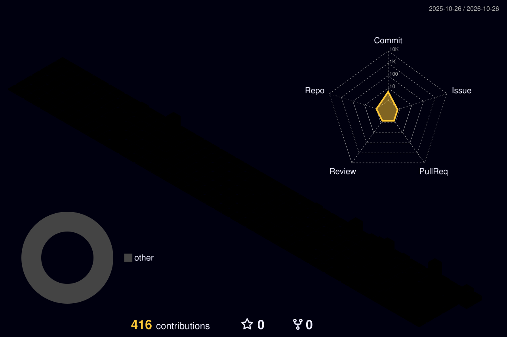

  

  
  
  
  <!--  -->

---

### 👋 About me

I build and run the software behind a real e-commerce business, from the storefront to order management, marketplace feeds and customer messaging. Most of my work lives in **private repositories**, so the contribution graph below tells the story better than the public repos.

- 🛒 **E-commerce**: storefront, order management, marketplace product feeds
- 🤖 **Automation**: WhatsApp bots, print/copy server tooling, internal dashboards
- 📱 **Mobile**: cross-platform apps with Flutter, like [TrackerVerse](https://github.com/seckin111/TrackerVerse), a series tracking app with discovery and social sharing

### 🧰 Tech stack

  
  <!-- Add the rest of your stack to the i= list, e.g. nodejs,php,react,mysql,docker,linux -->

### 🚀 What I'm building

| | Project | What it does |
| :-: | --- | --- |
| 🌐 | [**bestkirtasiye.com**](https://bestkirtasiye.com) | E-commerce site for a stationery store, live in production |
| 📦 | **OrderMan** | Order management system |
| 🔄 | **FeedMan** | Product feed manager for marketplaces |
| 🖨️ | **CopyMan** | Print & copy service backend with WhatsApp customer messaging |

🔒 These projects are private. Happy to walk through them on request.

### 📈 Activity

  

  <picture>
    <source media="(prefers-color-scheme: dark)" srcset="https://streak-stats.demolab.com?user=MehmetJank&theme=github-dark-blue&hide_border=true&background=0D1117" />
    
  </picture>

